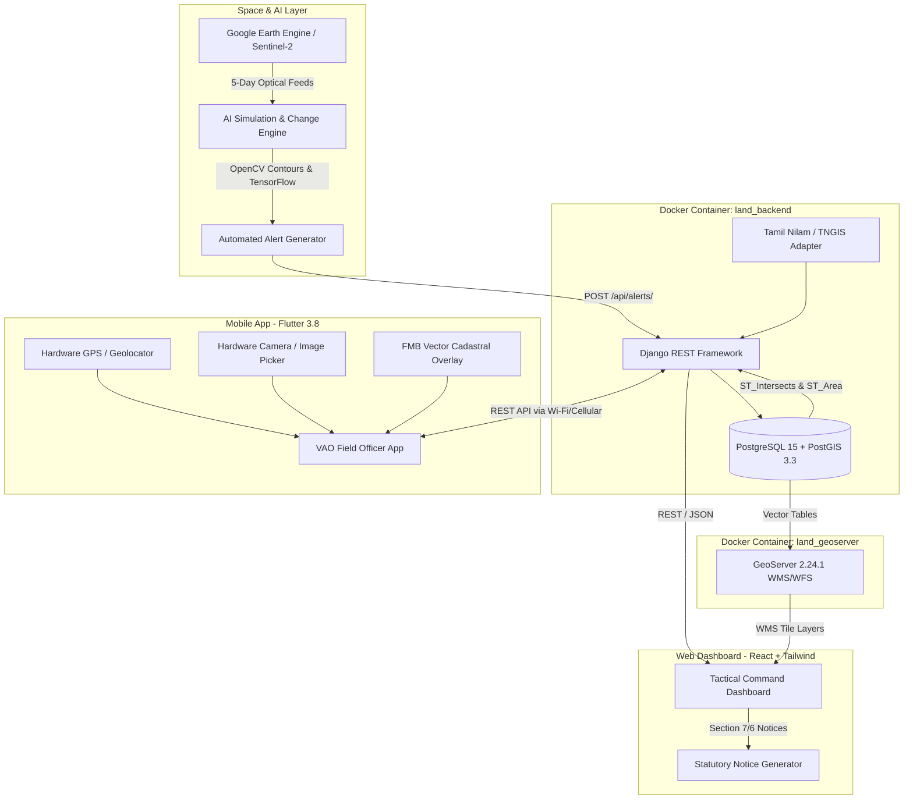
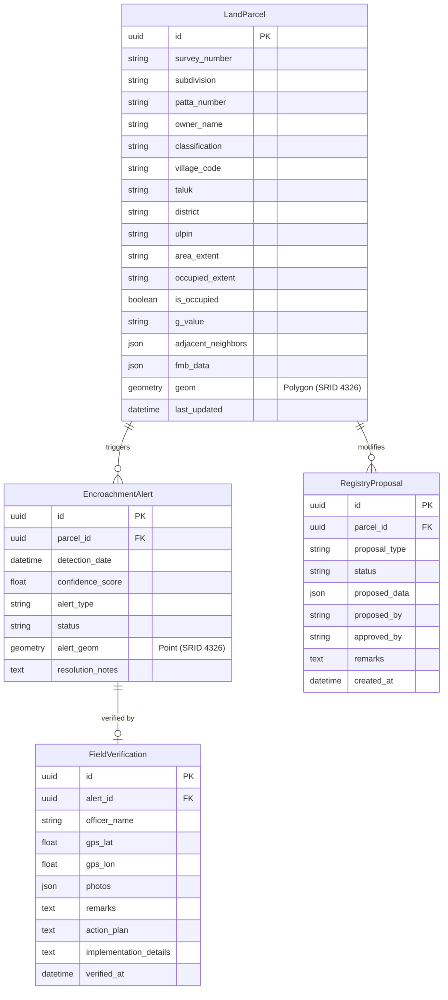

# GEOMMAND: Master Technical & Operational Documentation
## GIS-Based Mapping of Government Land to Monitor Real-Time Encroachment
**Department of Revenue and Disaster Management & Land Administration, Government of Tamil Nadu**  
**Initiative:** Niral Thiruvizha 2026 (Naan Mudhalvan Innovation Hackathon)  
**Lead Developers & System Architects:** Prakash Ramakrishnan, Mukesh S, Vidhyapathi R  
**Target Jurisdiction:** Salem District Command Node (Salem West, Omalur, Attur, Mettur, Salem South)

---

## Table of Contents
1. [Executive Summary & System Vision](#1-executive-summary--system-vision)
2. [End-to-End System Architecture](#2-end-to-end-system-architecture)
3. [User Authentication & Role-Based Access Control (RBAC)](#3-user-authentication--role-based-access-control-rbac)
   - [3.1 Complete Directory of the 17 System Roles](#31-complete-directory-of-the-17-system-roles)
   - [3.2 Quick Demo Switcher Mechanics](#32-quick-demo-switcher-mechanics)
   - [3.3 Mobile Field App Authentication & Backend Gateway](#33-mobile-field-app-authentication--backend-gateway)
4. [Comprehensive Feature Catalog & Technology Implementation](#4-comprehensive-feature-catalog--technology-implementation)
   - [4.1 Tactical GIS Sentinel Map & Multi-Scale LOD](#41-tactical-gis-sentinel-map--multi-scale-lod)
   - [4.2 AI Satellite Change Detection Engine](#42-ai-satellite-change-detection-engine)
   - [4.3 Tamil Nilam & Cadastral FMB Integration](#43-tamil-nilam--cadastral-fmb-integration)
   - [4.4 Field Officer Verification Mobile App](#44-field-officer-verification-mobile-app)
   - [4.5 Statutory Legal Notice Pipeline (Act III of 1905)](#45-statutory-legal-notice-pipeline-act-iii-of-1905)
   - [4.6 Field Operations Task Board & Kanban](#46-field-operations-task-board--kanban)
   - [4.7 Continuous AI Simulation Daemon](#47-continuous-ai-simulation-daemon)
   - [4.8 Strategic Analytics & MIS Invoicing Reporting](#48-strategic-analytics--mis-invoicing-reporting)
5. [Database Architecture & Spatial Schemas](#5-database-architecture--spatial-schemas)
6. [API Specifications & REST Endpoints](#6-api-specifications--rest-endpoints)
7. [Salem District Master Demo Scenarios](#7-salem-district-master-demo-scenarios)
8. [Deployment, Infrastructure & Quick Start Guide](#8-deployment-infrastructure--quick-start-guide)

---

## 1. Executive Summary & System Vision

### 1.1 The Problem
Across Tamil Nadu's 38 districts and over 16,000 revenue villages, public lands—particularly waterbodies (*Eri, Kulam, Kanmoi*), river basins, public roadsides, and grazing reserves (*Meikkal Poramboke*)—face relentless illegal encroachment. 

Under the conventional administrative model:
* **Detection Latency:** Encroachments are discovered months or years after unauthorized structures have already completed RCC slab casting and occupancy.
* **Paper-Based Inefficiency:** Relies entirely on citizen grievances, manual petitions, and periodic physical foot patrols by overburdened Village Administrative Officers (VAOs).
* **High Eviction Hurdles:** Once concrete structures are occupied, evictions face prolonged civil litigation, stay petitions, and substantial administrative friction.

### 1.2 The GEOMMAND Solution
**GEOMMAND** re-engineers government land governance from a reactive enforcement model into an **autonomous, space-to-ground defense pipeline**:
1. **Space Sentinel:** Continuous 5-day satellite surveillance ingest via Google Earth Engine and high-resolution optical imagery.
2. **AI Computer Vision:** Automated multi-spectral differencing and building footprint isolation powered by TensorFlow and OpenCV.
3. **Spatial Cadastral Overlay:** PostGIS intersection checks (`ST_Intersects`) cross-referencing official Tamil Nilam A-Register boundaries and Field Measurement Book (FMB) coordinates.
4. **Mobile Ground Truth:** Direct automated task dispatch to the local VAO’s mobile terminal with mandatory GPS geofencing and geotagged photographic evidence.
5. **Statutory Eviction Enforcement:** Instant generation and serving of Show-Cause Notices under **Section 7** and Eviction Orders under **Section 6** of the **Tamil Nadu Land Encroachment Act (Act III of 1905)**.

```
┌─────────────────────────────────────────────────────────────────────────────┐
│                          THE 5-STAGE DEFENSE PIPELINE                       │
├───────────────┬───────────────┬───────────────┬──────────────┬──────────────┤
│    STAGE 1    │    STAGE 2    │    STAGE 3    │   STAGE 4    │   STAGE 5    │
│   SATELLITE   │  AI DETECTION │    POSTGIS    │  FIELD APP   │ STATUTORY    │
│   MONITORING  │  DIFFERENCING │ SPATIAL CHECK │  DISPATCH    │ ENFORCEMENT  │
├───────────────┼───────────────┼───────────────┼──────────────┼──────────────┤
│ Sentinel-2 &  │ OpenCV Edge + │ ST_Intersects │ VAO GPS      │ Section 7 /  │
│ PlanetScope   │ TensorFlow    │ on Govt / FMB │ Geofenced    │ Section 6    │
│ 5-Day Revisit │ Footprints    │ Cadastral Map │ Ground Truth │ TN Act 1905  │
└───────────────┴───────────────┴───────────────┴──────────────┴──────────────┘
```

---

## 2. End-to-End System Architecture

GEOMMAND utilizes an enterprise-grade, distributed microservices architecture designed for mission-critical reliability, spatial precision, and zero-lag rendering.



### Infrastructure Summary
| Service Name | Container / Environment | Port | Primary Responsibilities |
| :--- | :--- | :--- | :--- |
| **`land_db`** | `postgis/postgis:15-3.3` | `5432` | Spatial storage, geometry topology, R-Tree spatial indexing |
| **`land_backend`** | Python 3.11, Django 4.2, GeoDjango | `8000` | Core business logic, legal pipelines, REST API endpoints |
| **`land_geoserver`**| `docker.osgeo.org/geoserver:2.24.1` | `8081` | OGC WMS/WFS vector streaming, spatial tile cache |
| **`land_adminer`** | `adminer:latest` | `8080` | Direct database administration & spatial query inspection |
| **`Tactical Dashboard`**| Node.js / Vite / React 18 / Tailwind | `5173` | Strategic map, alert triage, executive dashboards |
| **`Field Officer App`**| Flutter 3.8 (Web/Android APK) | `5174` | Ground survey, GPS geofencing, geotagged evidence capture |
| **`AI Simulation`**| Python 3 Native Daemon | Local CLI | Autonomous district-wide satellite change simulation |

---

## 3. User Authentication & Role-Based Access Control (RBAC)

GEOMMAND features a comprehensive 5-tier, 17-role access hierarchy that mirrors the administrative structure of the Government of Tamil Nadu Revenue & Disaster Management Department.

### 3.1 Complete Directory of the 17 System Roles

```
┌─────────────────────────────────────────────────────────────────────────────┐
│                       17 SYSTEM ROLES & ACCESS TIERS                        │
├─────────────────┬──────────────────┬─────────────────┬──────────────────────┤
│ CATEGORY        │ ROLE CODE        │ OFFICIAL TITLE  │ JURISDICTION LEVEL   │
├─────────────────┼──────────────────┼─────────────────┼──────────────────────┤
│ 1. Core         │ ADMIN            │ System Admin    │ State-Wide (All TN)  │
│                 │ COLLECTOR        │ District Coll.  │ District (Salem)     │
│                 │ TAHSILDAR        │ Tahsildar       │ Taluk (Salem West)   │
│                 │ VAO              │ Village Officer │ Village (Kannankur.) │
│                 │ INSPECTOR        │ Revenue Insp.   │ Revenue Firka        │
├─────────────────┼──────────────────┼─────────────────┼──────────────────────┤
│ 2. Technical    │ GIS              │ GIS Analyst     │ Spatial Geodatabase  │
│                 │ SURVEYOR         │ Cadastral Surv. │ FMB Baseline Stones  │
│                 │ AI               │ AI Officer      │ Model Weights & GEE  │
│                 │ DATA_ENTRY       │ Data Operator   │ A-Register Mutations │
├─────────────────┼──────────────────┼─────────────────┼──────────────────────┤
│ 3. Legal        │ LEGAL            │ Legal Officer   │ Act III Litigation   │
│                 │ ENFORCEMENT      │ Eviction Squad  │ Physical Recovery    │
├─────────────────┼──────────────────┼─────────────────┼──────────────────────┤
│ 4. Intelligence │ ANALYTICS        │ Analytics Off.  │ District Metrics     │
│                 │ PLANNING         │ Planning Off.   │ Urban Master Plan    │
│                 │ HEAD             │ Dept. Secretary │ Executive Oversight  │
├─────────────────┼──────────────────┼─────────────────┼──────────────────────┤
│ 5. Support      │ SECURITY         │ Security Lead   │ Audit Logs & 2FA     │
│                 │ API              │ API Manager     │ TNGIS Gateway Sync   │
│                 │ TRAINING         │ Training Lead   │ Officer Onboarding   │
└─────────────────┴──────────────────┴─────────────────┴──────────────────────┘
```

#### Detailed Breakdown of Key Operational Roles:
1. **District Collector (`COLLECTOR`)**
   * **Scope:** Entire Revenue District (Salem).
   * **Permissions:** Executive summary, inter-departmental task escalation (PWD, Highways, Forest, Police), final approval for high-value Section 6 eviction orders.
   * **Active Views:** Executive Hub, District Tactical Map, Threat Intelligence, Executive Approvals.
2. **Tahsildar (`TAHSILDAR`)**
   * **Scope:** Taluk-level jurisdiction (e.g., Salem West Taluk).
   * **Permissions:** Statutory competent authority under Tamil Nadu Act III of 1905. Authorizes and issues legal Section 7 Show-Cause Notices and Section 6 Eviction Orders; assigns field verification tasks to VAOs.
   * **Active Views:** Taluk Intelligence, GIS Zoning Matrix, Tactical Queue, Village Ops Monitor, Registry Approvals.
3. **Village Administrative Officer (`VAO`)**
   * **Scope:** Village-level jurisdiction (e.g., Kannankurichi Village).
   * **Permissions:** Conducts on-site verification with mobile GPS, inspects FMB measurements, submits ground truth reports, and uploads geotagged on-site photographs.
   * **Active Views:** Village Map Hub, Ground Verification Queue, FMB Cadastral Sheets.
4. **System Administrator (`ADMIN`)**
   * **Scope:** State-wide infrastructure.
   * **Permissions:** User management, role provisioning, system telemetry, database syncing, audit log inspection.

### 3.2 Quick Demo Switcher Mechanics
In the web dashboard (`frontend/src/App.jsx`), a single-click **Quick Role Switcher** is provided to enable live demonstrations without requiring repeated username/password entry:
* **Category Tabs:** Filter between `Core`, `Technical`, `Legal`, `Intelligence`, and `Support`.
* **Automatic Jurisdiction Scoping:** When selecting a role, the system automatically assigns the appropriate demo territory:
  ```javascript
  if (roleId === 'COLLECTOR') jurisdiction = { level: 'DISTRICT', value: 'Salem' };
  if (roleId === 'TAHSILDAR') jurisdiction = { level: 'TALUK', value: 'Salem West' };
  if (roleId === 'VAO') jurisdiction = { level: 'VILLAGE', value: 'Omalur North' };
  if (roleId === 'INSPECTOR') jurisdiction = { level: 'TALUK', value: 'Mettur' };
  ```
* **Default Superuser Credentials (Django Admin / REST API):**
  * **URL:** `http://localhost:8000/admin/`
  * **Username:** `admin`
  * **Password:** `admin123` (or seeded via `python manage.py createsuperuser`)

### 3.3 Mobile Field App Authentication & Backend Gateway
The Field Officer Flutter app runs either directly on Android physical devices (via the compiled `field_officer_app.apk`) or in a desktop Chrome emulator:
* **Dynamic IP Auto-Detection:** The startup script `START_GEOMMAND.bat` automatically queries `ipconfig` for the workstation’s local Wi-Fi IPv4 address (e.g., `192.168.1.15`).
* **In-App Backend Configuration:** Officers can tap the gear icon in the mobile app header to configure the target backend IP:
  ```dart
  String backendUrl = "http://${configuredIp}:8000/api/";
  ```
* **Offline-First Synchronization:** If the field officer loses mobile data in rural terrain, completed verification reports, GPS coordinates, and photographs are cached locally on device memory and synced automatically upon regaining signal.

---

## 4. Comprehensive Feature Catalog & Technology Implementation

| Feature Name | Module / View | Applied Technologies | Technical Role & Mechanism |
| :--- | :--- | :--- | :--- |
| **Tactical GIS Sentinel Map** | `frontend/src/components/Map.jsx` | React 18, Leaflet, React-Leaflet, CartoDB Positron / Satellite Basemaps | Real-time interactive spatial map rendering parcels, encroachment threat polygons, color-coded classifications, and live GPS pins. |
| **Multi-Scale Level of Detail (LOD)** | `Map.jsx`, PostGIS GeoJSON | PostGIS `ST_Simplify`, Leaflet Zoom Events (`zoomend`) | Prevents browser freeze: Macro zoom (8–12) renders district risk heatmaps; Micro zoom (16–18) renders precise vector survey lines, FMB stones, and building outlines. |
| **AI Satellite Change Detection** | `scripts/ai_simulation.py`, `core/views.py` | Google Earth Engine, OpenCV, TensorFlow CNN | Analyzes optical image differences across 5-day intervals; isolates new roof and wall footprints; triggers automatic spatial alerts. |
| **Tamil Nilam & Cadastral FMB Engine** | `core/models.py`, `CadastralDetailModals.jsx` | PostgreSQL, PostGIS, GeoDjango, JSONField | Stores official 'A' Register data, ULPIN codes, F-lines, G-lines, and ladder offsets; runs `ST_Intersects` against government parcels. |
| **Field Officer Mobile Verification** | `field_officer_app/lib/main.dart` | Flutter 3.8, `geolocator: ^14.0.2`, `image_picker: ^1.2.1` | Mobile application for field officers; enforces GPS geofencing (must be within 50m of parcel boundary) to prevent fraudulent remote sign-offs. |
| **Mobile FMB Sheet Viewer** | `field_officer_app/lib/cadastral_sheets.dart` | Flutter CustomPainter, `flutter_map: ^8.3.0`, `latlong2` | Custom vector rendering of official Field Measurement Book (FMB) baseline stones, ladder offsets, and encroached sub-divisions on mobile. |
| **Statutory Legal Notice Generator** | `frontend/src/components/CadastralDetailModals.jsx` | React Modals, HTML5 Canvas / Print CSS, Web Crypto | Formats official, legally defensible Section 7 Show-Cause and Section 6 Eviction notices under Tamil Nadu Act III of 1905 with QR verification codes. |
| **Field Ops Task Board & Kanban** | `frontend/src/components/FieldOpsTaskBoard.jsx` | React, Lucide Icons, REST PATCH API | Interactive triage pipeline moving alerts across 16 stages (from `NEW` to `VAO_ASSIGNED`, `VAO_SUBMITTED`, and `SECTION_6_ORDERED`). |
| **Continuous AI Simulation Node** | `scripts/ai_simulation.py` | Python 3, `urllib.request`, JSON | Background daemon that queries the database and injects realistic multi-threat satellite encroachment alerts into the tactical map during live demos. |
| **MIS Reports & Invoicing System** | `invoice_1_dev.html`, `invoice_2_gis.html`, `invoice_3_server.html` | Semantic HTML5, CSS Grid, SVG Badges | Complete administrative cost recovery and audit trail documentation detailing development, GIS processing, and server infrastructure costs. |

---

### Detailed Feature Deep-Dives

#### 4.1 Tactical GIS Sentinel Map & Multi-Scale LOD
* **Problem Addressed:** Previous evaluation panels questioned how the system handles rendering thousands of survey parcels across an entire district without memory lag or visual clutter.
* **Implementation:**
  * **Zoom 8–12 (District Macro View):** Clustered threat heatmaps summarizing encroachment risk percentages across taluks (Salem West, Omalur, Attur, Mettur).
  * **Zoom 13–15 (Taluk Semi-Detailed View):** Cadastral boundaries appear without heavy internal dimension labels.
  * **Zoom 16–18 (Cadastral Micro View):** Individual sub-division lines, baseline F-lines, ladder offsets, encroacher names, and ULPIN badges are rendered at full vector precision.
  * **Tactical 1-Click Presets:** Quick camera glide buttons on the dashboard instantly re-center the map to critical focus parcels (Mookaneri Lake, Suramangalam, NH-44 Omalur) at Zoom 17.

#### 4.2 AI Satellite Change Detection Engine
* **Satellite Feeds:** Configured for automated ingestion of Sentinel-2 (10m resolution, 5-day revisit) and high-resolution PlanetScope / Cartosat optical feeds.
* **Computer Vision Pipeline:**
  1. **Radiometric Calibration & Cloud Masking:** Google Earth Engine eliminates cloud shadows and atmospheric distortion.
  2. **Bi-Temporal Differencing:** OpenCV aligns images from Day $T_0$ (baseline survey) and Day $T_1$ (current satellite pass).
  3. **Feature Isolation:** TensorFlow convolutional neural network segments newly constructed tin roofs, concrete slabs, and brick masonry boundaries.
  4. **PostGIS Overlay:** The centroid coordinates are transmitted to the backend. The backend executes:
     ```sql
     SELECT id, survey_number, classification, ST_Area(geom) 
     FROM core_landparcel 
     WHERE ST_Intersects(geom, ST_SetSRID(ST_MakePoint(78.1725, 11.6983), 4326)) 
       AND classification IN ('Waterbody', 'Government', 'Roadside');
     ```
  5. If an intersection is confirmed, an `EncroachmentAlert` record is created with confidence score and assigned status `NEW`.

#### 4.3 Tamil Nilam & Cadastral FMB Integration
* **Data Harmony:** Direct mapping to the official Tamil Nadu Land Records Portal (**Tamil Nilam**).
* **Key Attributes Tracked:**
  * **ULPIN:** Unique Land Parcel Identification Number (e.g., `608W14201A9876`).
  * **Classification:** Waterbody Poramboke (*நஞ்சை நீர்நிலை*), Government Poramboke (*அரசு புறம்போக்கு*), Roadside (*நெடுஞ்சாலை புறம்போக்கு*), Temple Land (*கோயில் நிலம்*), Forest (*வன நிலம்*).
  * **Guideline Value ($G$-Value):** Standard Tamil Nadu Registration Department guideline value per sq.ft (e.g., ₹2,100 / sq.ft).
  * **Adjacent Neighbor Boundary Table:** Identifies adjacent patta owners (e.g., North: Patta 340, A. Selvam) to immediately isolate which neighboring landowner has breached their legal boundary into government land.
  * **FMB Geometry:** Complete Field Measurement Book records with F-line (boundary vectors), G-line (central baselines), and ladder offsets (perpendicular offset measurements to physical stones).

#### 4.4 Field Officer Verification Mobile App (Flutter)
* **Zero Fraud / GPS Geofencing:** Field officers cannot submit verification reports while sitting in an office. The app queries `geolocator` and computes the Haversine distance between the device's live GPS coordinates and the parcel boundary. If distance $> 50\text{ meters}$, submission is blocked with an alert: *"You must be on-site to submit verification"*.
* **Geotagged Photographic Proof:** Camera evidence is tagged with non-editable on-image watermarks:
  * Latitude & Longitude (e.g., `11.6983° N, 78.1725° E`)
  * Date & Time Stamp (IST)
  * Officer Name & ID
  * Survey Number & Taluk
* **On-Screen FMB Superimposition:** The mobile app draws the official cadastral polygon over the live satellite map, allowing the officer to walk the perimeter and pinpoint the exact physical breach.

#### 4.5 Statutory Legal Notice Pipeline (Tamil Nadu Act III of 1905)
* **Legal Grounding:** Encroachment removal in Tamil Nadu is governed strictly by the **Tamil Nadu Land Encroachment Act (Act III of 1905)**. Failure to follow statutory procedures results in eviction orders being quashed by the High Court of Madras.
* **GEOMMAND Automated Compliance:**
  1. **Section 7 Notice (Show-Cause):** When the Tahsildar accepts the VAO’s verified ground truth, the system generates an official Section 7 notice:
     * Specifying the exact unauthorized occupied area (e.g., *2,400 sq.ft inside Survey 142/1A*).
     * Citing the penalty assessment under Section 3 and 5.
     * Giving the encroacher a mandatory 15-day statutory window to show cause.
  2. **Section 6 Order (Eviction & Summary Removal):** If the encroacher fails to show cause within the statutory timeframe, the Tahsildar clicks *"Order Section 6 Eviction"*:
     * Authorizes the Revenue Inspector and police enforcement squad to enter the land, demolish unauthorized masonry, and resume government possession.
     * Automatically logs the recovery value to the district treasury ledger.

---

## 5. Database Architecture & Spatial Schemas

All spatial data is stored in **PostgreSQL 15** with the **PostGIS 3.3** extension using standard WGS 84 (`SRID 4326`) geometry.



### Alert Lifecycle State Machine
```
[NEW] 
  │
  ├──► [COLLECTOR_ACCEPTED] ──► [TAHSILDAR_ACCEPTED]
  │                                    │
  │                                    ▼
  │                             [VAO_ASSIGNED]
  │                                    │
  │                                    ▼
  │                             [VAO_SUBMITTED]
  │                                    │
  │                                    ▼
  │                          [INSPECTOR_APPROVED]
  │                                    │
  │                                    ▼
  │                           [SECTION_7_ISSUED] (15-Day Show-Cause)
  │                                    │
  │                                    ▼
  │                           [SECTION_6_ORDERED] (Eviction & Recovery)
  │
  └──► [FALSE_POSITIVE] / [REJECTED_BOUNDARY]
```

---

## 6. API Specifications & REST Endpoints

The Django REST backend (`http://localhost:8000/api/`) exposes clean, fully documented GeoJSON and JSON endpoints.

| Method | Endpoint | Description | Query Parameters |
| :--- | :--- | :--- | :--- |
| `GET` | `/api/parcels/` | Returns GeoJSON FeatureCollection of all cadastral parcels. | `village_code`, `classification`, `is_occupied`, `search` |
| `GET` | `/api/parcels/presets/` | Returns the 4 curated Salem demonstration focus parcels. | None |
| `GET` | `/api/parcels/{id}/` | Detailed single parcel record including FMB offset arrays and neighbor boundaries. | None |
| `GET` | `/api/alerts/` | Returns all active encroachment alerts formatted as GeoJSON Points. | `status`, `alert_type`, `parcel` |
| `POST`| `/api/alerts/` | Ingests a new satellite-detected encroachment alert from AI daemon. | Body: `{ parcel, confidence_score, alert_type, status, alert_geom }` |
| `PATCH`| `/api/alerts/{id}/` | Updates an alert's statutory lifecycle status (e.g. issuing Section 7). | Body: `{ status: "SECTION_7_ISSUED" }` |
| `GET` | `/api/verifications/`| Returns list of all submitted mobile field ground truth reports. | `officer_name`, `alert` |
| `POST`| `/api/verifications/`| Submits a new mobile ground verification with GPS coordinates & photos. | Body: `{ alert, officer_name, gps_lat, gps_lon, remarks, photos }` |
| `GET` | `/api/proposals/` | Registry mutation proposals for boundary corrections. | `status`, `proposal_type` |

---

## 7. Salem District Master Demo Scenarios

These four pre-seeded demonstration scenarios are specifically configured for live evaluation reviews.

### Scenario 1: Mookaneri Lake Poramboke (Kannankurichi, Salem West)
* **Classification:** `Waterbody` (*நஞ்சை நீர்நிலை*)
* **Survey Number:** `142/1A` | **ULPIN:** `608W14201A9876`
* **Department:** TN Water Resources Department (PWD)
* **Breach Details:** Adjacent patta holder (Patta 340, A. Selvam) extended a masonry compound wall 18 meters into the lake basin, encroaching **2,400 sq.ft (5.5 Cents)** of water storage area.
* **Enforcement Status:** Section 7 Show-Cause Notice issued; recovery value: **₹50.4 Lakhs**.

### Scenario 2: Suramangalam Commercial Poramboke (Salem West)
* **Classification:** `Government` (*அரசு புறம்போக்கு*)
* **Survey Number:** `56/2B` | **ULPIN:** `608W05602B1140`
* **Breach Details:** Unauthorized commercial warehouse shed and truck parking lot constructed over government revenue poramboke.
* **Enforcement Status:** Flagged for immediate Section 6 eviction order.

### Scenario 3: Omalur NH-44 Roadside Highway Reserve
* **Classification:** `Roadside` (*நெடுஞ்சாலை புறம்போக்கு*)
* **Survey Number:** `119/4` | **ULPIN:** `608W11904A2201`
* **Breach Details:** Automobile repair workshop built zinc-sheet sheds into the National Highway 44 right-of-way, encroaching **850 sq.ft**.

### Scenario 4: Kondalampatti Heavy Vehicle Scrap Yard (Salem South)
* **Classification:** `Roadside` (*நெடுஞ்சாலை புறம்போக்கு*)
* **Survey Number:** `76/2B` | **ULPIN:** `608W07602B9032`
* **Breach Details:** Unlicensed metal scrap yard occupying **1,650 sq.ft** of government land near the arterial junction.

---

## 8. Deployment, Infrastructure & Quick Start Guide

### 8.1 System Prerequisites
* **Operating System:** Windows 10/11, Ubuntu 22.04 LTS, or macOS
* **Docker Desktop:** Installed and running (requires WSL2 on Windows)
* **Node.js:** v18.x or v20.x LTS
* **Python:** 3.10+ with `virtualenv`
* **Flutter SDK:** 3.8+ (for mobile app compilation)

### 8.2 One-Click Startup Procedure
The entire ecosystem can be started using the automated root batch launcher:
```bash
START_GEOMMAND.bat
```

This single command automatically performs the following 5-step sequence:
1. **Network IP Detection:** Scans `ipconfig` for the workstation’s active Wi-Fi IPv4 address.
2. **Container Launch:** Runs `docker-compose up -d` to launch PostgreSQL/PostGIS, GeoServer, and Adminer.
3. **Database Migration & Seeding:** Executes `python manage.py migrate` and `python manage.py seed_data` inside the container.
4. **Dashboard Launch:** Starts the React Tactical Dashboard dev server on `http://localhost:5173`.
5. **Mobile & AI Launch:** Launches the Flutter web emulator on `http://localhost:5174` and initializes the continuous AI simulation daemon.

### 8.3 Manual Service URLs
* **Tactical Command Dashboard:** `http://localhost:5173`
* **Field Officer Mobile Terminal:** `http://localhost:5174`
* **Django Command Backend / Admin:** `http://localhost:8000/admin/`
* **GeoServer Spatial Portal:** `http://localhost:8081/geoserver`
* **Adminer Database Console:** `http://localhost:8080`

---
*Documentation Compiled & Validated for Niral Thiruvizha 2026 Final Review.*
