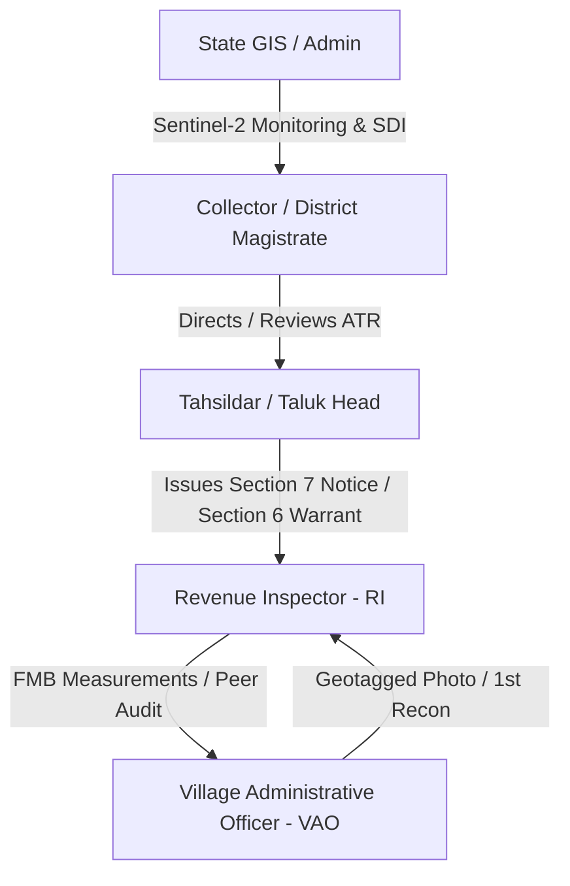

# GEOMMAND Frontend Audit & Comprehensive Refactoring Master Plan

## 1. Executive Summary & Objective

The frontend of **GEOMMAND** was developed as a rapid multi-role prototype (`App.jsx` currently spans **4,717 lines / 339 KB**). While visually rich, it is burdened with:
1. **Extensive Fake / Demo Data & Background Simulators** (e.g., `feedInterval` injecting `LIVE-XXXX` alerts every 45s, `Math.random()` valuation figures, and static tables).
2. **Duplicated & Fragmented Views** (6 separate executive dashboards, 3 separate map wrappers, 4 overlapping field ops tabs).
3. **Role Bloat** (17 hypothetical roles, 12 of which only render dummy 2-row tables, diluting the statutory 4-tier Tamil Nadu Revenue workflow).
4. **Disconnected Backend Capabilities** (Newly built backend engines—High Court ATR PDF, FMB Cadastral Sketch, 7-Day SLA Breaches, Tier-1 Waterbody Classifications, and STAR 3.0 Deed Locks—are either under-utilized or missing in the dashboard).

**Objective:** Transform the monolithic prototype into a clean, modular, role-streamlined GovTech application strictly powered by real PostGIS Django REST endpoints.

---

## 2. In-Depth Frontend Audit: Identified Issues

### A. Demo Data & Simulated States (To Be Eliminated)
| Component / Location | Fake / Demo Element | Real Backend Replacement |
|---|---|---|
| `App.jsx:4220-4244` | `feedInterval`: Generates fake `LIVE-XXXX` alerts every 45 seconds with random taluk & type. | Direct polling or SWR of `GET /api/alerts/` (GeoJSON FeatureCollection from PostGIS). |
| `App.jsx:4251-4268` | `registryRequests`: Hardcoded array (`UP-8821`, `CR-991A`) and random ID generation. | `GET /api/parcels/` & `GET /api/verifications/` real workflow states. |
| `App.jsx:248-258` | `OfficerAssignmentModal`: Math.random() land values (`₹${(Math.random() * 20 + 5).toFixed(1)}Cr`). | Real `parcel.market_value_inr` or calculated guidance value from parcel properties. |
| `App.jsx:362-475` | `DistrictAnalyticsView`: Static numbers (`14,242 Ha`, `₹24.2 Cr`, `92.4%`, fake bar charts). | Real aggregated metrics computed from `alerts` and `parcels` datasets. |
| `App.jsx:480-505` | `SystemHealthView`: Static fake CPU 24% and memory metrics with looping dummy bars. | Real PostgreSQL PostGIS node status + Celery/Redis health check API. |
| `App.jsx:4481-4534` | `OperationalListView`: Hardcoded grievance rows, dummy directives (`ORD-2026-101`), static satellite lists. | Consolidate or replace with real audit logs and real statutory order history. |
| `App.jsx:3771-3802` | `DashboardView` Status Bar: Static string `"14,242.8 Ha"`, `"98.4% Secured"`, `"12,482 Parcels"`. | Dynamic summation of active `parcels` area and real counts from backend. |

---

### B. Redundant & Duplicated Views (To Be Consolidated)

```
CURRENT FRAGMENTED STATE (6 Dashboards & 3 Maps):
├── DashboardView (Generic)
├── InspectorDashboardView
├── InspectorExecutiveView
├── VillageExecutiveView
├── TalukExecutiveView
├── CollectorExecutiveView
├── MapView
├── DistrictMapView
└── VillageMapHubView

CONSOLIDATED TARGET ARCHITECTURE (4 Unified Core Views):
├── 1. UnifiedCommandDashboard.jsx (Role-Aware: Collector / Tahsildar / RI / VAO / GIS)
│      └── Dynamic KPI banner, 7-Day SLA Breaches counter, Tier-1 Threat Matrix, Taluk Filter
├── 2. CadastralSentinelMap.jsx (Single robust Leaflet / PostGIS Map)
│      └── Tamil Nilam parcel overlay, FMB measurement ladder view, Satellite basemap switcher
├── 3. FieldOpsTaskBoard.jsx (Unified Evidence & Enforcement Engine)
│      └── Geofenced photos, FMB sketches, Section 7/6 PDFs, STAR 3.0 deed freeze, Peer audit
└── 4. HighCourtComplianceView.jsx (District Collector Statutory Portal)
│      └── W.P. 34091/2023 ATR affidavit generator, Waterbody encroachment register, 1-Click PDF export
```

---

### C. Role Rationalization (From 17 Down to the 5 Statutory TN Roles)

The current 17 roles create unnecessary cognitive overhead and dead menu items. We will streamline the application to the 5 official Tamil Nadu Land Administration roles:



1. **`COLLECTOR` (District Collector & District Magistrate):**
   - High Court W.P. 34091/2023 Compliance & ATR Affidavit generation (`/api/compliance/high-court-atr/`).
   - Section 6 Eviction Warrant approvals.
   - STAR 3.0 Registration freeze authorization (`/api/alerts/{id}/star3_lock/`).
   - District-wide 7-day SLA breach monitoring (`is_sla_breached`).

2. **`TAHSILDAR` (Taluk Executive Magistrate):**
   - Section 7 Show-Cause Notice issuance with automated FMB Cadastral Sketch (`/api/alerts/{id}/download_section_7/`).
   - Humanitarian Rehabilitation reassignment for vulnerable huts (`/api/alerts/{id}/humanitarian_rehabilitation/`).
   - Dispatching Revenue Inspectors and receiving peer audit findings.

3. **`INSPECTOR` (Revenue Inspector / RI & Surveyor):**
   - FMB Cadastral ladder measurements (`fmb_measurements`).
   - Cross-taluk Peer Audit verification when false positives are claimed (`peer_audit_taluk`).
   - Demolition / eviction enforcement logging.

4. **`VAO` (Village Administrative Officer):**
   - First responder on-site verification with geofenced evidence photos (`/api/verifications/`).
   - Encroachment structure classification: Commercial, Temporary Pandal, or Vulnerable Housing (`structure_category`).

5. **`ADMIN` / `GIS` (State Spatial Data Infrastructure & Admin):**
   - System overview, PostGIS sync, Sentinel AI parameters, raw parcel management (`/api/parcels/`).

---

## 3. Real Backend API Integration Matrix

| Frontend Feature / Action | Current State | Real Target API Endpoint | HTTP Method |
|---|---|---|---|
| Initial Alert Load | Static `[]` + fake timer | `/api/alerts/` | `GET` |
| Filter by District / Taluk / Tier | Local JS filter | `/api/alerts/?taluk=Salem+West&tier=TIER_1_CRITICAL` | `GET` |
| Load Tamil Nilam Parcels | Basic `pRes` fetch | `/api/parcels/` & `/api/parcels/presets/` | `GET` |
| Issue Section 7 Notice + PDF | Local alert & simulated PDF | `/api/alerts/{id}/issue_section_7/` & `/api/alerts/{id}/download_section_7/` | `POST` / `GET` |
| Generate High Court ATR Report | Non-existent in `App.jsx` | `/api/compliance/high-court-atr/?district={district}` | `GET` (Binary PDF) |
| STAR 3.0 Deed Registration Freeze | Simulated alert box | `/api/alerts/{id}/star3_lock/` | `POST` |
| Humanitarian Housing Aid | Simulated button | `/api/alerts/{id}/humanitarian_rehabilitation/` | `POST` |
| Dispatch Peer Audit | Simulated state change | `/api/alerts/{id}/mark_false_positive/` (Auto-routes to peer Taluk) | `POST` |
| Fetch Cadastral FMB Sketch | Mock canvas/image | `/api/alerts/{id}/fmb_sketch/` | `GET` |
| VAO Field Evidence Submission | Simulated photo upload | `/api/verifications/` | `POST` (Multipart/form-data) |

---

## 4. Phase-by-Phase Implementation Plan

### Phase 1: Architectural Modularization & Dead Code Purge
- Remove `feedInterval` fake generator (lines 4220-4244 in `App.jsx`).
- Remove hardcoded static arrays in `OperationalListView` (grievances, directives, satellite matrices).
- Remove 12 phantom roles from `ROLES` and `MENU_STRUCTURE`, keeping only `COLLECTOR`, `TAHSILDAR`, `INSPECTOR`, `VAO`, and `ADMIN`.
- Extract sub-views out of `App.jsx` into modular files under `frontend/src/views/`:
  - `views/UnifiedDashboardView.jsx`
  - `views/SentinelMapView.jsx`
  - `views/HighCourtComplianceView.jsx`
- Keep `frontend/src/components/FieldOpsTaskBoard.jsx` as the primary enforcement hub.

### Phase 2: Real API Store & Data Layer
- Create `frontend/src/api/client.js` with structured helper methods:
  - `fetchAlerts(filters)`
  - `fetchParcels()`
  - `downloadSection7PDF(alertId)`
  - `downloadHighCourtATR(district)`
  - `executeStar3Lock(alertId)`
  - `dispatchHumanitarianAid(alertId)`
  - `submitPeerAudit(alertId, data)`
- Implement error handling and loading skeletons (replacing generic alerts and broken states).

### Phase 3: Dashboard Redesign with Real GovTech Metrics
- **SLA Breaches Countdown Widget:** Highlight any encroachment pending > 7 days under Section 7 Notice.
- **Tiered Encroachment Badges:**
  - `TIER_1_CRITICAL`: Red glowing badge (Waterbodies, PWD Canals, Highways).
  - `TIER_2_MEDIUM`: Orange badge (G-Square / Commercial plots).
  - `TIER_3_MONITORING`: Blue badge (Fallow grazing lands).
- **FMB Cadastral Sketch Preview:** Inline modal displaying the survey ladder offsets directly from `/api/alerts/{id}/fmb_sketch/`.
- **1-Click High Court ATR Generator:** Placed directly on the Collector Executive dashboard with Salem District pre-selection.

### Phase 4: Full Validation & Smoke Testing
- Verify Vite development server (`npm run dev`) runs without warnings.
- Verify production bundle builds cleanly (`npm run build`).
- Smoke test each role:
  - Log in as Collector -> Download High Court ATR PDF.
  - Log in as Tahsildar -> Issue Section 7 Notice & download court notice with FMB sketch.
  - Log in as Inspector -> View FMB survey ladder & peer audit dispatch.
  - Log in as VAO -> Verify field evidence photo display.
- Validate end-to-end against the Dockerized backend (`land_backend:8000` & `land_db:5432`).
