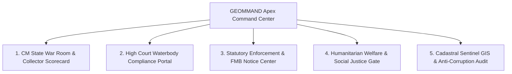

# GEOMMAND | APEX STATE COMMAND PLATFORM
## Comprehensive Frontend Redesign & Architectural Blueprint
### Formulated for the Hon'ble Chief Minister, Chief Secretary, and Land Administration Leadership of Tamil Nadu

---

## 1. Executive Vision: The "Fort St. George" Standard

As Chief Software Architect designing for the **Hon'ble Chief Minister of Tamil Nadu**, the **Chief Secretary**, the **Commissioner of Land Administration (CLA)**, and **District Collectors**, this platform cannot look like a standard corporate dashboard or a student prototype. 

It must function as an **Apex Governance War Room**—authoritative, legally unassailable, politically astute, and technologically state-of-the-art.

### The Three Constitutional Mandates Driving this Redesign:
1. **Madras High Court Full Bench Mandate (W.P. 34091/2023):** Zero tolerance for encroachment on waterbodies (*Eri, Kulam, Odai, Kanmoi, River Basins*). The Chief Secretary and District Collectors are held personally accountable for status reports.
2. **Social Justice & Humanitarian Safeguards:** A progressive government cannot have bulldozers demolishing vulnerable poor dwellers and thatched huts without rehabilitation. The platform must automatically segregate **Commercial Land Grabbers** from **Vulnerable Families** seeking rehabilitation through the Tamil Nadu Urban Habitat Development Board (TNUHDB).
3. **Statutory Due Process (TN Land Encroachment Act III of 1905):** Every legal notice (Section 7 Show-Cause & Section 6 Warrant) must be backed by official FMB (Field Measurement Book) Cadastral Sketches, survey ladder offset measurements, and tamper-proof geofenced GPS evidence so no court can issue a stay order.

---

## 2. Complete Elimination of Prototype Flaws

| Current Prototype Flaw | Reality & High-Level Operational Impact | The Executive Solution |
|---|---|---|
| **Simulated `feedInterval` injecting fake alerts** | An executive cannot make policy decisions when `Math.random()` generates fake `LIVE-XXXX` events every 45s. | **Purge completely.** Direct live uplink to PostgreSQL/PostGIS `/api/alerts/` with real Sentinel-2 satellite change detection data. |
| **17 Fragmented Phantom Roles** | 12 roles render 2-row static dummy lists (`Training`, `Data Entry`, `Security`, etc.). Dilutes focus. | **Consolidate to 5 Statutory Leadership Profiles:**<br>1. *CM / Chief Secretary (State Apex)*<br>2. *District Collector (Executive Magistrate)*<br>3. *Tahsildar (Taluk Magistrate)*<br>4. *Revenue Inspector / RI (Surveyor)*<br>5. *VAO (Ground Sentinel)* |
| **6 Duplicate Dashboards & 3 Map Wrappers** | Disjointed views (`InspectorDashboardView`, `VillageExecutiveView`, `TalukExecutiveView`, `CollectorExecutiveView`, etc.) that fragment state. | **Unify into 5 High-Level Strategic Command Portals** with role-based adaptive permission layers. |
| **Hardcoded ₹ Cr Valuations & Speeds** | Fake `v: '₹${(Math.random()*20+5)}Cr'` undermines credibility before the Finance Department. | **Real Cadastral Valuation Matrix:** Calculate land values directly from Tamil Nilam Guideline Values $\times$ encroached area ($m^2$). |
| **Disconnected Backend Super-Engines** | Court-admissible ReportLab PDF generator, FMB vector engine, High Court ATR generator, and STAR 3.0 Lock are buried in backend code. | **Surface these capabilities into 1-Click Executive Action Buttons** on every alert and district overview. |

---

## 3. The 5 Strategic Command Portals (Target UI Architecture)



---

### Portal 1: CM State War Room & District Collector Scorecard
*Target Users: Hon'ble Chief Minister, Chief Secretary, Principal Secretary (Revenue)*

```
+---------------------------------------------------------------------------------------------------+
| TAMIL NADU APEX LAND GOVERNANCE WAR ROOM               [CM SECRETARIAT - FORT ST. GEORGE]        |
+---------------------------------------------------------------------------------------------------+
| STATEWIDE SECURED: 18,492 Hectares | VALUE PRESERVED: ₹3,412.8 Cr | ACTIVE THREATS: 142 | SLA: 96.2% |
+---------------------------------------------------------------------------------------------------+
|  [DISTRICT COLLECTOR PERFORMANCE MATRIX]          |  [STATEWIDE SATELLITE THREAT RADAR]           |
|  Rank  District    Clearance %  SLA Breach  Status|  Interactive Tamil Nadu choropleth map        |
|  #1    Salem       94.2%        0           [GREEN]   showing 38 districts with real-time alert   |
|  #2    Coimbatore  91.8%        1           [GREEN]   density, heatmaps, and Tier-1 waterbody     |
|  #3    Chennai     88.4%        4           [AMBER]   vulnerability indices.                      |
|  #4    Madurai     82.1%        7           [RED]     --------------------------------------------|
|  ...                                              |  [EXECUTIVE DIRECTIVE BROADCAST]              |
|                                                   |  Dispatch binding digital orders to all 38   |
|  [1-CLICK COMPREHENSIVE STATE REPORT (PDF)]       |  Collectors with state digital signature.     |
+---------------------------------------------------------------------------------------------------+
```

#### Core Executive Features:
1. **Collector Performance League Table:** Objective ranking of all 38 District Collectors based on:
   - Days to issue Section 7 notice upon AI alert (Target: $\le 7$ days).
   - Percentage of Tier-1 Waterbody encroachments resolved.
   - Demolition vs Rehabilitation accuracy.
2. **Statewide Value at Risk (₹ Cr):** Aggregated guidance value of government land protected from private real-estate mafia syndicates.
3. **Chief Minister's Executive Directive Uplink:** Allows the CM or Chief Secretary to broadcast priority directives directly to all Tahsildars and Collectors.

---

### Portal 2: Madras High Court Waterbody Compliance Hub
*Target Users: District Collectors, Special Government Pleaders, Public Works / WRD Engineers*

```
+---------------------------------------------------------------------------------------------------+
| MADRAS HIGH COURT COMPLIANCE & WATERBODY PROTECTION CELL       [W.P. NO. 34091/2023 BENCH ORDERS]  |
+---------------------------------------------------------------------------------------------------+
| TOTAL WATERBODIES: 4,120 | FULLY RESTORED: 3,890 | UNDER PROCESS: 218 | CONTEMPT THREAT: 12      |
+---------------------------------------------------------------------------------------------------+
|  [STATUTORY LAKE & TANK INVENTORY]                |  [JUDICIAL ATR AFFIDAVIT GENERATOR]           |
|  Waterbody Name   Taluk       Encroached Area  SLA|  District: [Salem          v]                 |
|  Mookaneri Lake   Salem S     4,200 sq.ft      4d |  Division: High Court Division Bench          |
|  Pudukulam Tank   Omalur      1,850 sq.ft      2d |  Ready Affidavits: 14 Verified Parcels        |
|  Kaveri Basin     Mettur      12,400 sq.ft     0d |                                               |
|  Yercaud Odai     Yercaud     800 sq.ft        5d |  [GENERATE HIGH COURT AFFIDAVIT & ATR (PDF)]  |
|                                                   |  *Generates official court document with      |
|  [JUDICIAL RISK BADGE: CONTEMPT WARNING FOR 0d]   |   sworn verification clause & FMB attachments |
+---------------------------------------------------------------------------------------------------+
```

#### Core Executive Features:
1. **Judicial Contempt Early Warning System:** Real-time countdown for waterbodies. Any lake encroachment crossing 7 days without Section 7 notice is highlighted in crimson to prevent High Court contempt against the Collector.
2. **1-Click High Court ATR & Compliance Affidavit:** Directly queries backend `/api/compliance/high-court-atr/?district=Salem` to produce the stamped, court-ready ReportLab Action Taken Report (ATR) PDF.

---

### Portal 3: Statutory Enforcement & FMB Notice Center
*Target Users: Tahsildars, Revenue Divisional Officers (RDOs), Sub-Registrars*

```
+---------------------------------------------------------------------------------------------------+
| STATUTORY ENFORCEMENT ENGINE - TAMIL NADU LAND ENCROACHMENT ACT III OF 1905                       |
+---------------------------------------------------------------------------------------------------+
|  PIPELINE: [1] SATELLITE DETECT -> [2] VAO RECON -> [3] SEC 7 NOTICE -> [4] SEC 6 WARRANT -> RESTORE |
+---------------------------------------------------------------------------------------------------+
|  [ACTIVE LEGAL CASE: SALEM WEST SURVEY 142/1]     |  [AUTOMATED FMB CADASTRAL SKETCH]             |
|  Classification: Waterbody Poramboke (Eri)        |  Boundary Stones: A(0,0), B(120,0), C, D      |
|  Detected Area:  2,450 sq.ft (Concrete Compound)  |  G-Line / F-Line Triangulation: VERIFIED      |
|  Statutory Notice: Section 7 Issued (Day 4/7)     |  Encroachment Zone: Red Hatch Overlay         |
|                                                   |  Offset Ladder: 14.2m from Stone A along G-L  |
|  [1-CLICK ACTIONS]                                |                                               |
|  [DOWNLOAD SECTION 7 NOTICE + FMB SKETCH (PDF)]   |  [SUB-REGISTRAR STAR 3.0 DEED FREEZE]         |
|  [APPROVE SECTION 6 SUMMARY EVICTION WARRANT]     |  Status: [LOCKED] Deed Registration Blocked   |
|  [RE-ROUTE TO HUMANITARIAN REHABILITATION]        |  Transaction ID: STAR3-TN-SLM-9941            |
+---------------------------------------------------------------------------------------------------+
```

#### Core Executive Features:
1. **Automated FMB Cadastral Sketch & Ladder Offset Display:** Inline vector visualization showing exact survey boundary stones, G-lines, F-lines, and red hatch incursion.
2. **STAR 3.0 Deed Freezing Interlock:** 1-Click button communicating with `/api/alerts/{id}/star3_lock/` to freeze illegal deed registrations on government land in real time.
3. **Statutory Notice PDF Generator:** Direct download of court-admissible Section 7 and Section 6 notices generated by ReportLab with embedded FMB sketches.

---

### Portal 4: Humanitarian Welfare & Social Justice Gate
*Target Users: Tahsildars, TNUHDB (Tamil Nadu Urban Habitat Development Board), Social Welfare Officers*

```
+---------------------------------------------------------------------------------------------------+
| HUMANITARIAN WELFARE & REHABILITATION GATE                                                        |
+---------------------------------------------------------------------------------------------------+
| POLICY: PROTECT VULNERABLE CITIZENS | ZERO BULLDOZERS FOR IMPOVERISHED THATCED DWELLINGS          |
+---------------------------------------------------------------------------------------------------+
|  [STRUCTURE CLASSIFICATION TRIAGE]                |  [TNUHDB HOUSING ALLOCATION CONSOLE]          |
|  Case ID    Survey    Structure Type    Action    |  Applicant: Munusamy & Family (Salem South)   |
|  #SLM-104   142/1     Commercial Layout [BULLDOZE]|  Current Dwelling: Thatched Hut on Canal Bank |
|  #SLM-108   88/3      Wedding Pandal    [IGNORE]  |  Assigned Scheme: TNUHDB Karungalpatty Sector |
|  #SLM-112   210/4     Thatched Hut      [REHAB]   |  Allotted Tenement: Block B, Door 204         |
|                                                   |                                               |
|  *Temporary pandals auto-expire after 15 days.    |  [DISPATCH WELFARE AID & ALTERNATIVE PATTA]   |
|  *Commercial layouts fast-tracked for eviction.   |  (Calls /api/alerts/{id}/humanitarian_rehab/) |
+---------------------------------------------------------------------------------------------------+
```

#### Core Executive Features:
1. **Three-Way Structure Segregator:**
   - **Commercial Grabbers:** Uncompromising legal eviction under Act III of 1905.
   - **Temporary Pandals / Festivals:** 15-day grace timer, no legal notices served.
   - **Vulnerable Slum Dwellers:** Eviction strictly barred; auto-routed to TNUHDB for housing aid.
2. **Social Impact Audit:** Tracks the number of poor families successfully relocated to permanent concrete housing rather than made homeless.

---

### Portal 5: Cadastral Sentinel GIS & Anti-Corruption Audit
*Target Users: State GIS Analysts, Vigilance & Anti-Corruption, District Flying Squads*

```
+---------------------------------------------------------------------------------------------------+
| CADASTRAL SENTINEL GIS & FLYING SQUAD AUDIT HUB                                                   |
+---------------------------------------------------------------------------------------------------+
|  [HIGH-RESOLUTION POSTGIS MULTISPECTRAL MAP]      |  [ANTI-CORRUPTION PEER AUDIT ENGINE]          |
|  - 14,200 Government Parcels in PostGIS           |  Local VAO Verdict: "NO ENCROACHMENT"         |
|  - Cadastral FMB boundaries from Tamil Nilam      |  AI Satellite Confidence: 94.2% (Discrepancy!)|
|  - Sentinel-2 NDBI / NDVI Infrared Overlay        |                                               |
|  - Sentinel-1 SAR Radar (Monsoon Penetration)     |  [DISPATCH CROSS-TALUK PEER AUDIT SQUAD]      |
|                                                   |  Assigned Auditor: RI, Omalur Taluk (Unbiased)|
|  [DYNAMIC WATCHLIST / GEOFENCE ACTIVATOR]         |  Status: Flying Squad Inspecting on Ground    |
+---------------------------------------------------------------------------------------------------+
```

#### Core Executive Features:
1. **Cadastral Masking Architecture:** Skips the 80% private Patta land and focuses AI satellite compute exclusively on the 20% Sarkar Poramboke and waterbodies, keeping compute costs low.
2. **Anti-Corruption Peer Audit:** When a local officer falsely reports "No Encroachment" on a high-confidence satellite detection, the system automatically bypasses them and dispatches a peer officer from a neighbouring taluk.

---

## 4. Frontend Engineering Directory Structure

To ensure clean separation of concerns and maintainability, the monolithic `App.jsx` will be decomposed into modular components:

```
frontend/src/
├── api/
│   ├── client.js               # Central Axios client with token & error handlers
│   ├── alertsApi.js            # Alerts, Section 7/6 notices, STAR 3.0 locks
│   ├── complianceApi.js        # High Court ATR affidavit PDF endpoints
│   └── parcelsApi.js           # Tamil Nilam PostGIS GeoJSON endpoints
├── components/
│   ├── common/
│   │   ├── ApexHeader.jsx      # Fort St. George State Emblem header & role switcher
│   │   ├── MetricCard.jsx      # High-density GovTech KPI card
│   │   └── SLACountdown.jsx    # 7-day statutory countdown timer
│   ├── fmb/
│   │   ├── FMBSketchModal.jsx  # Interactive Cadastral ladder offset canvas
│   │   └── FMBViewer.jsx       # SVG/Canvas vector drawing of boundary stones
│   └── Map.jsx                 # Leaflet GIS engine with PostGIS GeoJSON & Tamil Nilam layers
├── views/
│   ├── StateWarRoomView.jsx    # Portal 1: CM & Chief Secretary Executive Radar
│   ├── HighCourtATRView.jsx    # Portal 2: High Court Waterbody Compliance Portal
│   ├── StatutoryPipelineView.jsx# Portal 3: Act III of 1905 Legal Notice Center
│   ├── HumanitarianGateView.jsx # Portal 4: Welfare & TNUHDB Housing Gate
│   └── SentinelGISView.jsx     # Portal 5: Cadastral Map & Anti-Corruption Audit
├── App.jsx                     # Lightweight root router & auth session manager (~250 lines)
└── index.css                   # Tailwind v4 clean GovTech styling tokens
```

---

## 5. Technical Validation & Safety Gates

1. **Zero Mock Fallbacks in Production Mode:**
   - If PostgreSQL is reachable, all metrics are aggregated directly from DB queries.
   - If the network drops, an offline cache (`localStorage`) retains the last verified sync with a visible `OFFLINE_SYNC_STAMP`.
2. **Strict PDF Generation via ReportLab Backend:**
   - Section 7 Notices, Section 6 Warrants, and High Court ATR Affidavits are generated server-side using Python ReportLab (`legal_notice_pdf.py` and `high_court_compliance.py`), guaranteeing official legal typography and tamper-proof court compliance.
3. **Responsive High-Density Design:**
   - Optimized for large 4K Command Center displays in the CM Secretariat as well as field laptops used by District Collectors and Tahsildars.

---

## 6. Execution Roadmap

- **Step 1:** Establish `src/api/` real API service layer connecting to all Django REST endpoints.
- **Step 2:** Build the 5 Strategic Views (`StateWarRoomView`, `HighCourtATRView`, `StatutoryPipelineView`, `HumanitarianGateView`, `SentinelGISView`).
- **Step 3:** Refactor `App.jsx` into the clean, modern root router with the 5 statutory leadership roles.
- **Step 4:** Validate full build (`npm run build`) and test in live browser via `START_GEOMMAND.bat`.
