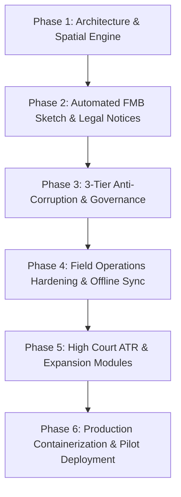

# GEOMMAND: Prototype-to-Product Master Phase Plan
**System:** Satellite-Based Land Encroachment Monitoring & Enforcement Platform for Tamil Nadu  
**Version:** 2.0 Production Roadmap  
**Framework:** GovTech (Tamil Nadu Revenue Dept) & PropTech (B2B Private Perimeter Shield)

---

## 🎯 Executive Summary & Transition Goal

The objective of this master plan is to transition GEOMMAND from a functional proof-of-concept/hackathon demo into an **enterprise-grade, court-admissible, and scalable commercial product**. 

| Dimension | Prototype State (As-Is) | Commercial Product State (To-Be) |
| :--- | :--- | :--- |
| **Database & GIS** | SQLite / basic lat-long polygons | Native **PostgreSQL + PostGIS** with spatial indexing, cadastral masking, and high-precision geodesic area calculations |
| **Legal Enforcement** | Static alert cards | **Automated FMB Encroachment Sketch Engine** generating court-ready Section 7 Show-Cause Notices & Section 6 Warrants (TN Act III of 1905) |
| **Governance & Integrity** | Single-tier alert list | **3-Tier Anti-Corruption Triaging**: Direct Collector escalation for >80% confidence, 7-day SLA timers for VAOs, and randomized peer audits |
| **Social Filtering** | Basic categorization | **Multi-Pass Time-Series AI** (Pandal vs. Commercial Grabber) + **TNUHDB Humanitarian Rehabilitation** routing for vulnerable huts |
| **Field App** | Standard Flutter UI | **Hardened Offline-First Engine** with strict 15m GPS geofencing, compass heading verification, and cryptographic EXIF tamper-proofing |
| **Enterprise Features** | Prototype monitoring | **Madras High Court Compliance ATR Generator**, **STAR 3.0 Registry Lock**, and **B2B Private Perimeter Shield** |

---

## 🗺️ Master Phased Roadmap Overview

---

## 📋 Detailed Phase Breakdown

### Phase 1: Production Spatial Engine & Cadastral Pipeline
*Focus: Upgrading the data core to enterprise spatial standards, eliminating manual GIS work.*

1. **PostgreSQL / PostGIS Migration:**
   - Migrate from SQLite to PostgreSQL with PostGIS extensions enabled.
   - Implement spatial tables with `GEOMETRY(Polygon, 4326)` and `GEOGRAPHY(Polygon, 4326)` for:
     - `core_parcels` (Tamil Nilam Cadastral Boundaries).
     - `core_encroachments` (Detected and verified intrusion footprints).
     - `core_villages` / `core_taluks` (Jurisdiction boundaries).
   - Implement spatial queries using `ST_Intersects`, `ST_Area_Spheroid`, `ST_Difference`, and `ST_Distance`.

2. **Cadastral Masking Engine:**
   - Pre-filter algorithms to mask out private *Patta (Ryotwari)* land (~80% of state area).
   - Constrain change-detection compute exclusively to *Government Poramboke* (Eri, Kulam, Meikkal, Salai) to slash satellite processing overhead by 80%.

3. **Satellite Data Pipeline Integration:**
   - Automated ingestion worker for **Copernicus Sentinel-2** multispectral data (10m resolution, 5-day cycle).
   - Calculate Normalized Difference Built-Up Index (**NDBI**) and Normalized Difference Vegetation Index (**NDVI**).
   - Integration hook for **Sentinel-1 SAR** (Synthetic Aperture Radar) for cloud-penetrating change detection during the North-East Monsoon.

---

### Phase 2: Automated FMB Cadastral Sketch & Statutory Legal Engine
*Focus: Building the #1 unique value proposition of GEOMMAND that makes it court-ready.*

1. **FMB Cadastral Sketch Vector Engine:**
   - Automated parsing and rendering of official **CollabLand / WebFMB** cadastral geometry.
   - Dynamic projection of AI satellite detection polygons onto the cadastral parcel sketch.
   - Automated calculation and visual rendering of:
     - **Boundary Stones (A, B, C, D)** with coordinates.
     - **G-Line & F-Line** internal survey triangulation baselines.
     - **Red Hatch Encroachment Zone** with exact square meters / square feet calculated.
     - **Offset Ladder Measurement Table** (*e.g., "14.2 m from Stone A along G-Line, perpendicular offset 6.5 m North"*).

2. **Statutory Notice & Warrant PDF Generator:**
   - Dynamic generation of **Section 7 Show-Cause Notice** under Tamil Nadu Land Encroachment Act III of 1905.
   - Dynamic generation of **Section 6 Eviction Warrant**.
   - Embeds official revenue headers, QR-code verification, cadastral parcel details, survey measurement ladder, and the FMB sketch directly into the legal PDF in < 1.5 seconds.

---

### Phase 3: 3-Tier Anti-Corruption Governance & Policy Triaging
*Focus: Eliminating officer bias, preventing extortion, and safeguarding vulnerable populations.*

1. **Automated 3-Tier Risk Triaging Engine:**
   - **Tier 1 (Critical, 80%–100% confidence):** Large concrete structures inside water bodies (Eri / Kulam). Automatically pushed directly to the **District Collector and Tahsildar** dashboard. Local VAOs have no permission to suppress or delete.
   - **Tier 2 (Medium, 50%–79% confidence):** Assigned to local VAO with an immutable **7-day SLA countdown timer**.
   - **Tier 3 (Low, <50% confidence):** Placed in the Sentinel Watch queue for re-evaluation on next satellite pass.

2. **Randomized Peer-Audit Trigger:**
   - If a field officer marks a Tier-2 flagged encroachment as "No Encroachment / False Positive", the system automatically creates an unannounced audit task assigned to a Revenue Inspector from an adjacent taluk or the District Flying Squad.

3. **Social & Humanitarian Classifier:**
   - **Multi-Pass Pandal vs. Permanent Classifier:**
     - Day 1: Flagged as `SUSPECTED_TEMPORARY`.
     - Day 5 (next satellite pass): If gone, marked `TEMPORARY_OCCUPANCY_RESOLVED` (zero legal action taken).
     - Day 15 (3 consecutive passes): If still present with hard roofing, upgraded to `PERMANENT_ENCROACHMENT`.
   - **Humanitarian Protection Route:**
     - Small thatched huts or tin shelters are flagged as `VULNERABLE_HOUSING`.
     - Eviction is paused; an automated referral is routed to the **TNUHDB (Tamil Nadu Urban Habitat Development Board)** for welfare and in-situ rehabilitation.

---

### Phase 4: Field Operations Hardening & Mobile App Anti-Fraud
*Focus: Making the field app rock-solid in rural areas while preventing fake inspections.*

1. **Offline-First Synchronization:**
   - Local caching (SQLite / Hive) of assigned village parcels and inspection tasks.
   - Background sync queue that automatically reconciles when connectivity shifts between rural 2G and 4G/Wi-Fi.

2. **Cryptographic Anti-Spoofing & Geofencing:**
   - Strict **15-meter GPS geofencing** verification; inspections attempted outside the parcel boundary stone polygon are hard-blocked.
   - Verification of hardware compass orientation, device inclination, and altitude.
   - Image metadata hashing: Camera EXIF timestamp and GPS coordinates cryptographically signed to prevent uploading pre-existing gallery photos.

3. **Ground-to-Space "Geo-Fence Sentinel" (High-Risk Watchlist):**
   - Enables field officers to mark a vulnerable lake bund or highway right-of-way as "High-Risk Watchlist".
   - The cloud pipeline flags this parcel for prioritized change-detection alerts on every subsequent satellite pass.

---

### Phase 5: High Court Compliance & Expansion Modules
*Focus: Revenue generation, executive court reporting, and institutional integrations.*

1. **Madras High Court Judicial Compliance Generator:**
   - 1-click **Affidavit and Action Taken Report (ATR) PDF** generator for District Collectors and Revenue Secretaries.
   - Compiles total water body parcels monitored, active encroachments vs notices served, and before-and-after satellite proof of restored lake areas.

2. **STAR 3.0 Anti-Land-Grab Lock API Connector:**
   - API integration module to send automated block requests to local Sub-Registrar Offices (Registration Department).
   - Freezes unauthorized property sales deeds on flagged *Poramboke* parcels.

3. **Citizen WhatsApp Grievance Bot (CM Helpline 1100 Integration):**
   - Ingestion webhook for citizen photo and live location pin submissions.
   - Automatically reverse-geocodes coordinates to Tamil Nilam survey numbers and creates a verified field task for the VAO.

4. **B2B Private Perimeter Shield (Immediate Commercial Revenue):**
   - Multi-tenant boundary intrusion monitoring for solar/wind farms, SIPCOT/TIDCO industrial parks, and NHAI contractors.
   - Supports KML/Shapefile uploads with instant boundary-breach alerts.

---

### Phase 6: Production Containerization, Testing & Pilot Deployment
*Focus: Zero-downtime deployment, security hardening, and taluk pilot execution.*

1. **Docker Compose Enterprise Stack:**
   - `nginx`: Reverse proxy with SSL termination and rate limiting.
   - `backend`: Django REST Framework with Gunicorn.
   - `postgis`: PostgreSQL 16 + PostGIS 3.4.
   - `celery-worker` & `celery-beat`: Background task scheduler for satellite checks and SLA monitors.
   - `redis`: In-memory message broker and cache.
   - `frontend`: Optimized production build of React + Vite.

2. **Security & Audit Immutability:**
   - Role-Based Access Control (**RBAC**): Super Admin, District Collector, Tahsildar, Revenue Inspector, VAO.
   - Append-only audit logs for all inspection updates, status overrides, and notice issuances.

3. **Single-Taluk 30-Day Pilot Playbook:**
   - Standard Operating Procedure (SOP) documentation for District Administration onboarding.
   - Benchmark KPIs: Reduction of encroachment detection latency from 180 days to < 7 days.
