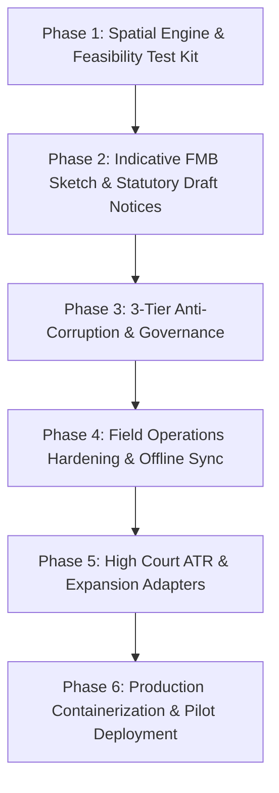

# GEOMMAND: Prototype-to-Product Master Phase Plan
**System:** Satellite-Based Land Encroachment Monitoring & Enforcement Platform for Tamil Nadu  
**Version:** 2.0 Production Roadmap (Harden & Verified)  
**Framework:** GovTech (Tamil Nadu Revenue Dept) & PropTech (B2B Private Perimeter Shield)  
**Legal Status:** All statutory procedures, timelines, and notice templates are **UNVERIFIED – pending formal Law Department & Revenue Administration sign-off**.  

---

## 🎯 Executive Summary & Transition Goal

The objective of this master plan is to transition GEOMMAND from a functional proof-of-concept into an **enterprise-grade, court-admissible, and scalable platform**. 

| Dimension | Prototype State (As-Is) | Commercial Product State (To-Be) |
| :--- | :--- | :--- |
| **Database & GIS** | SQLite / basic lat-long polygons | Native **PostgreSQL + PostGIS** with spatial indexing, cadastral masking, and high-precision geodesic area calculations (`EPSG:32644`) |
| **Legal Enforcement** | Static alert cards | **Indicative FMB Sketch & Statutory Draft Engine** generating draft Section 7 Show-Cause Notices & Section 6 Warrants (TN Act III of 1905 - UNVERIFIED) with SHA-256 and QR verification |
| **Governance & Integrity** | Single-tier alert list | **3-Tier Anti-Corruption Governance**: Collector direct escalation for high-confidence, configurable SLA timers in `DistrictLegalConfig`, and randomized peer audits |
| **Social Filtering** | Basic categorization | **Multi-Pass Time-Series AI** (Pandal vs. Commercial Grabber) + **TNUHDB Humanitarian Rehabilitation** routing for vulnerable huts |
| **Field App** | Standard Flutter UI | **Hardened Offline-First Engine** with dual configurable tolerances: 15m physical geofencing and 50m camera EXIF verification |
| **Enterprise Features** | Prototype monitoring | **Madras High Court Compliance ATR Generator**, **STAR 3.0 Registry Lock Adapter (Disabled)**, and **B2B Private Perimeter Shield** |

---

## 🗺️ Master Phased Roadmap Overview

---

## 📋 Detailed Phase Breakdown

### Phase 1: Production Spatial Engine & Satellite Feasibility Kit
*Focus: Upgrading the data core to enterprise spatial standards and verifying spectral detection feasibility.*

1. **PostgreSQL / PostGIS Migration:**
   - Spatial tables with `GEOMETRY(Polygon, 4326)` for `core_landparcel`, `core_encroachmentalert`, `core_revenuevillage`, `core_taluk`, and `core_district`.
   - High-precision geodesic area calculations using projected metric coordinates (`EPSG:32644` - UTM Zone 44N).

2. **Satellite Change-Detection Feasibility Kit (COMPLETED):**
   - Built `SatelliteFeasibilityKit` evaluating ground-truth validation CSVs against Copernicus Sentinel-2 L2A (and Sentinel-1) spectral signatures.
   - Computes bi-temporal **NDBI** (Built-up), **NDVI** (Vegetation), and **NDWI** (Water) changes.
   - Outputs precision, recall, F1 score, smallest detectable area ($m^2$), and cloud-gap statistics with deterministic offline fixtures.
   - Continuous 5-day live ingestion scheduled for production upon official Copernicus API activation.

---

### Phase 2: Indicative FMB Cadastral Sketch & Statutory Legal Engine (UNVERIFIED)
*Focus: Automated court-ready documentation with tamper-evident cryptographic verification.*

1. **FMB Cadastral Sketch Vector Engine:**
   - Generates SVG parcel sketches from boundary geometry, clearly watermarked `[INDICATIVE FMB]`.
   - Official `.dxf` survey ladder parsing held until sample CollabLand files are provided by the Survey Department.

2. **Statutory Notice & Warrant PDF Generator (UNVERIFIED):**
   - Generates draft **Section 7 Show-Cause Notice** and **Section 6 Eviction Warrant** under TN Act III of 1905.
   - Embeds machine-scannable 2D QR codes linking to public verification endpoint `/api/v1/verify/{doc_hash}/` with IP-based rate limiting (30/min) and zero citizen PII.
   - **Deny-by-Default Authority**: Signatory delegation is dynamically checked against `StatutoryNoticeAuthority` (no Tahsildar default; labeled UNVERIFIED).
   - **Configurable Deadlines**: Reply windows and vacate periods load from `DistrictLegalConfig` per district; zero hardcoded duration literals.

---

### Phase 3: 3-Tier Anti-Corruption Governance & Policy Triaging
*Focus: Eliminating officer bias, preventing extortion, and safeguarding vulnerable populations.*

1. **Automated 3-Tier Risk Triaging Engine:**
   - **Tier 1 (Critical, $\ge 80\%$ confidence):** Pushed directly to District Collector & Tahsildar dashboards. Local VAOs cannot suppress or delete.
   - **Tier 2 (Medium, $50\%–79\%$ confidence):** Assigned to local VAO with configurable operational SLA timers (`DistrictLegalConfig`).
   - **Tier 3 (Low, $<50\%$ confidence):** Placed in monitoring queue.

2. **Randomized Peer-Audit Trigger:**
   - Marking a Tier-2 flagged encroachment as "False Positive" triggers an unannounced peer audit assigned to an independent inspector.

3. **Humanitarian Protection Route:**
   - Thatched huts or tin shelters are flagged as `VULNERABLE_HOUSING`. Summary eviction under Section 6 is hard-blocked and referred to TNUHDB for rehabilitation.

---

### Phase 4: Field Operations Hardening & Mobile App Anti-Fraud (COMPLETED - M1)
*Focus: Offline-first mobile verification with dual cryptographic anti-spoofing.*

1. **Dynamic Token Authentication (M1-01):**
   - Live token authentication against `/api/auth/login/` with dynamic officer jurisdiction; no hardcoded passwords or prefilled credentials. Enforces mandatory inspection remarks ($\ge 10$ characters).

2. **Evidence Object Storage & Base64 Migration (M1-02):**
   - MinIO/S3 object storage with HMAC-SHA256 signed PUT/GET endpoints and safe base64 migration command (`migrate_base64_photos`).

3. **Offline Inspection Queue & Concurrency Dialog (M1-03):**
   - `QueuedInspection` offline sync queue in Flutter; HTTP 409 optimistic locking dialog presenting server vs local state diffs.

4. **Dual Configurable Spatial Tolerances (M1-04):**
   - **Physical Geofence:** Configurable device-to-parcel tolerance (`GEOFENCE_TOLERANCE_METERS`, default 15m in metric `EPSG:32644`).
   - **Photo EXIF Tamper Check:** Configurable camera-to-device limit (`PHOTO_EXIF_MISMATCH_LIMIT_METERS`, default 50m). Screens and audit events explicitly report which check failed.

---

### Phase 5: High Court Compliance & Expansion Adapters (UNVERIFIED)
*Focus: Executive compliance reporting and institutional integrations.*

1. **Madras High Court Judicial Compliance Generator:**
   - Action Taken Report (ATR) PDF generator for District Collectors; requires operative Writ Petition number configured per district (`DistrictLegalConfig`).

2. **ExternalSource Registry & Adapters (8 Government Adapters):**
   - TNGIS, CollabLand, Tamil Nilam, STAR 3.0, TNUHDB, Copernicus, CCTNS, CM Helpline. All adapters created and disabled by default.

---

### Phase 6: Production Containerization, Testing & Pilot Deployment
- Production Docker compose stack (Django, PostGIS, Geoserver, Redis, Celery, Nginx).
- Load testing with Locust; DPDP Act 2023 statutory privacy documentation.
